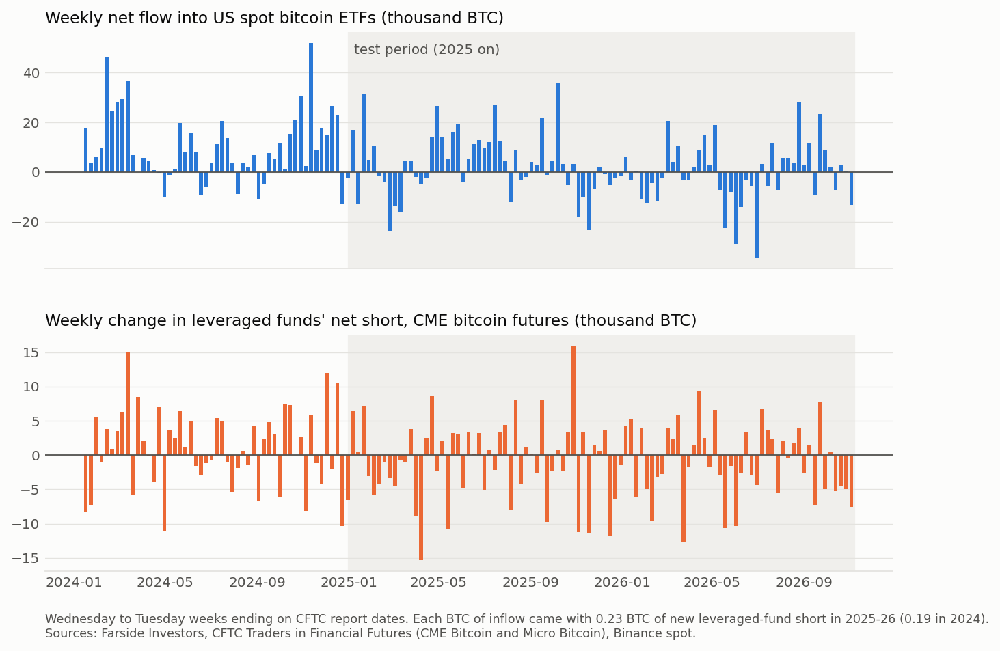

# How much of the bitcoin ETF bid is a basis trade?

US spot bitcoin ETFs took in about $55bn net between January 2024 and November 2026. Part of that money bets on price. Part of it belongs to hedge funds that buy ETF shares, short CME futures against them and collect the futures premium. I wanted a number for the second part.

I wrote the hypotheses, data rules, thresholds and pass lines in [PLAN.md](PLAN.md) and committed them before I ran any test. 2024 served as calibration; January 2025 to November 2026 is the test period.

The write-up with the full argument is on my site: [How much of the bitcoin ETF bid is a basis trade?](https://bykobuteyko.com/research/bitcoin-etf-basis/)



## Results (test period, 96 weeks, about 460 trading days)

**About a quarter.** For each BTC that flowed into the ETFs in a week, leveraged funds added 0.23 BTC of net short in CME bitcoin futures (95% CI 0.17 to 0.29, one-sided p < 0.0001). In 2024 the ratio was 0.19. ETF flow explains 27% of the weekly variation in that short. In the eight test weeks with inflows above 20,563 BTC (the 2024 80th percentile), leveraged funds added 4,700 BTC more short than in other weeks.

| Hypothesis | Verdict |
|---|---|
| H1. Large inflow weeks come with new leveraged-fund CME shorts | Supported, also at a 5%/3 Bonferroni line |
| H2. A sharp drop in the futures basis is followed by outflows | Not supported (p = 0.40) |
| H3. Yesterday's return predicts today's flow, and not the reverse | Not supported: the link runs both ways |

I made two predictions about the hedge ratio. I said it would land between 0.2 and 0.5 in the test period: it did, at 0.23. I also said it would fall below its 2024 level because the basis compressed. It rose from 0.19 to 0.23, so I got that one wrong, though the two confidence intervals overlap.

**H2.** I regressed the next five days of ETF flow on the past five-day change in the 90-day basis, with the past five-day return as a control. The basis coefficient has the predicted sign, but its confidence interval spans zero by a wide margin. Without the return control it still fails (p = 0.15). The event version is weak for a separate reason: the 2024 threshold (a drop of more than 2.23 percentage points in five days) fired on only 8 of 460 test days, because the basis moved less in 2025-26.

**H3.** A one standard deviation return on day t-1 comes with 0.21 standard deviations more flow on day t. The reverse link also shows up: a one standard deviation flow on day t-1 comes with a 0.19 standard deviation return on day t, and both sets of lags pass a joint Wald test at 5%. The return-to-flow side is larger summed over five lags (0.25 against 0.08), but the plan counts "both directions" as a failure, and I keep it that way. The flow-to-return link may come from settlement timing: for cash creations, issuers can buy the bitcoin on the day after the flow shows up. I have not tested that.

## What the 0.23 means and what it does not

CFTC reports positions by category. A leveraged-fund short can hedge an ETF holding, hedge spot bitcoin held somewhere else, or bet on a fall. If no other leveraged-fund shorts rise with ETF inflows, 0.23 is an upper bound on the basis-trade share of the flow. If some basis traders file under other categories, it is a lower bound. I can't separate the two with public data. Asset managers, the other big CME category, added 0.11 BTC of net long per BTC of ETF inflow over the same weeks.

The basis series comes from Binance quarterly futures, since CME price history isn't free. It tracks Deribit closely (daily correlation 0.97 in the test period). Against a rough CME series from Yahoo's front-month quote, the quarterly correlation is only 0.41, so treat H2 as a test of the offshore basis, which may differ from the premium the CME trade earns.

## Data

- Daily ETF flows: [Farside Investors](https://farside.co.uk/bitcoin-etf-flow-all-data/), US$m per fund, converted to BTC at the US close price.
- Positions: CFTC Traders in Financial Futures, futures only, CME Bitcoin (5 BTC) and Micro Bitcoin (0.1 BTC), via the public API.
- Spot and quarterly futures: Binance public API. Cross-checks: Deribit public API and Yahoo Finance BTC=F.

## Reproduce

```bash
pip install -r requirements.txt
python fetch.py
python analysis.py
python chart.py
```

`fetch.py` writes raw files to `data/` (not committed). `analysis.py` writes [results.txt](results.txt). Farside revises recent days, so a later run can shift the last weeks a little.
